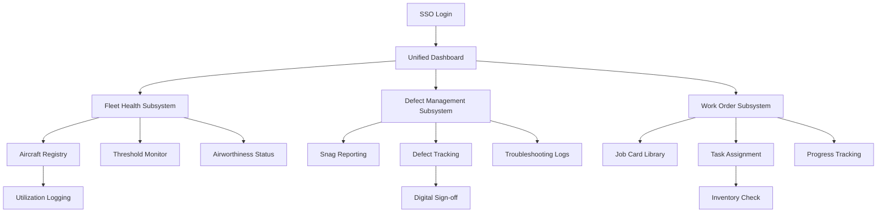

# Skyline Airlines Maintenance Department Subsystem - Product Requirements Document

## 1. Product Overview

Skyline Airlines Maintenance Department Subsystem is a comprehensive microfrontend platform designed to digitize and streamline aircraft maintenance operations. The system transforms manual, reactive maintenance processes into an integrated, proactive digital workflow that ensures fleet airworthiness and operational safety.

The platform serves maintenance engineers, technicians, and flight crews by providing real-time visibility into fleet health, defect management, and work order execution. Built with a microfrontend architecture, it enables seamless navigation across three specialized subsystems while maintaining consistent user experience and visual design.

## 2. Core Features

### 2.1 User Roles

| Role | Registration Method | Core Permissions |
|------|---------------------|------------------|
| Maintenance Engineer | SSO Authentication | Access all subsystems, create/edit work orders, sign off defects |
| Aircraft Technician | SSO Authentication | View assigned tasks, update work progress, log flight data |
| Flight Crew | SSO Authentication | Report defects/snags, view aircraft status |
| Maintenance Manager | SSO Authentication | Full system access, generate reports, manage assignments |

### 2.2 Feature Module

The maintenance platform consists of three integrated subsystems accessible through a unified interface:

1. **Fleet Health Dashboard**: Real-time fleet overview, aircraft registry, threshold monitoring, airworthiness status tracking
2. **Defect Management Portal**: Snag reporting, severity categorization, troubleshooting logs, digital sign-off workflows
3. **Work Order System**: Digital job cards, task assignment, progress tracking, inventory integration

### 2.3 Page Details

| Page Name | Module Name | Feature description |
|-----------|-------------|---------------------|
| Unified Dashboard | Navigation Header | Display user profile, subsystem switcher, notifications, logout |
| Unified Dashboard | Fleet Overview | Show total aircraft count, airworthy percentage, pending defects, active work orders |
| Fleet Health Subsystem | Aircraft Registry | View all aircraft with tail numbers, models, total flight hours, total cycles |
| Fleet Health Subsystem | Threshold Monitor | Track time-life components, display upcoming maintenance alerts, color-coded urgency levels |
| Fleet Health Subsystem | Airworthiness Status | Real-time Go/No-Go indicators, critical maintenance flags, status history |
| Fleet Health Subsystem | Utilization Logging | Input daily flight hours and cycles, validate data entry, update aircraft records |
| Defect Management Subsystem | Crew Reporting Portal | Mobile-responsive snag entry, photo attachment, aircraft selection, defect description |
| Defect Management Subsystem | Severity Categorization | Auto-classify defects as AOG (critical), MEL (non-critical), or Deferred (cosmetic) |
| Defect Management Subsystem | Troubleshooting Logs | Collaborative workspace for engineers, document tests performed, suspected root causes |
| Defect Management Subsystem | Digital Sign-off | Certified technician approval, corrective action documentation, regulatory compliance |
| Work Order Subsystem | Job Card Library | Browse standardized maintenance procedures, search by aircraft type or component |
| Work Order Subsystem | Task Assignment | Assign job cards to teams/technicians, set priorities, schedule maintenance windows |
| Work Order Subsystem | Inventory Integration | Check required parts availability, display stock levels, request parts procurement |
| Work Order Subsystem | Progress Tracking | Update task status (Scheduled → In Progress → Pending Inspection → Completed), add notes |

## 3. Core Process

### Maintenance Workflow Integration

The system follows an integrated workflow connecting all three subsystems:

1. **Fleet Health Monitoring**: System continuously monitors aircraft thresholds and flags upcoming maintenance requirements
2. **Work Order Generation**: Automatically creates job cards for scheduled maintenance and assigns to qualified teams
3. **Defect Discovery**: During maintenance, engineers log any discovered defects with severity classification
4. **Resolution Tracking**: Technicians troubleshoot and resolve defects, documenting all actions taken
5. **Digital Sign-off**: Certified personnel approve completed work, updating aircraft airworthiness status
6. **Fleet Status Update**: System automatically updates fleet health dashboard with completed maintenance

### User Navigation Flow

## 4. User Interface Design

### 4.1 Design Style

- **Primary Colors**: Skyline Blue (#1E40AF), Safety Orange (#F59E0B), Status Green (#10B981)
- **Secondary Colors**: Neutral Gray (#6B7280), Warning Red (#EF4444), Background Light (#F9FAFB)
- **Button Style**: Rounded corners (8px radius), subtle shadows, hover animations
- **Typography**: Inter font family, 14px base size, clear hierarchy with H1-H6
- **Layout**: Card-based design with consistent spacing (8px grid system), top navigation bar
- **Icons**: Aviation-themed icons, consistent line weight, intuitive symbolism

### 4.2 Page Design Overview

| Page Name | Module Name | UI Elements |
|-----------|-------------|-------------|
| Unified Dashboard | Navigation Header | Skyline logo left, subsystem switcher center, user menu right, notification bell with badge |
| Unified Dashboard | Fleet Overview | Three-column card layout, real-time metrics with progress rings, quick action buttons |
| Fleet Health | Aircraft Registry | Data table with sortable columns, search bar, filter dropdowns, export button |
| Fleet Health | Threshold Monitor | Timeline view with color-coded alerts, countdown timers, maintenance windows |
| Defect Management | Snag Reporting | Mobile-first form with camera integration, voice-to-text option, severity selector |
| Defect Management | Defect Tracking | Kanban-style board with drag-drop, priority indicators, assignee avatars |
| Work Orders | Job Card Library | Grid layout with card previews, category filters, search functionality |
| Work Orders | Task Assignment | Calendar view for scheduling, technician availability indicators, conflict warnings |

### 4.3 Responsiveness

- **Desktop-First Design**: Optimized for 1920x1080 resolution with responsive breakpoints
- **Mobile Adaptation**: Touch-friendly interfaces for tablets and smartphones
- **Tablet Optimization**: Landscape and portrait modes with appropriate touch targets
- **Progressive Enhancement**: Core functionality accessible across all device sizes

### 4.4 Microfrontend Integration

The unified platform implements a microfrontend architecture with:
- **Single Sign-On (SSO)**: Seamless authentication across all subsystems
- **Shared Navigation**: Consistent header and menu system across frameworks
- **Cross-Subsystem Communication**: Event-driven architecture for real-time updates
- **Consistent Styling**: Unified design system implementation across React, Vue, and Svelte
- **Independent Deployment**: Each subsystem can be updated without affecting others