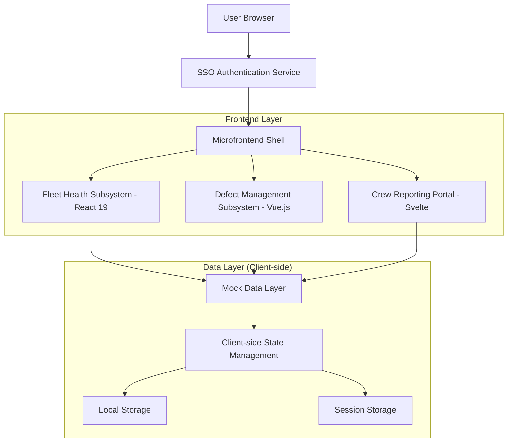
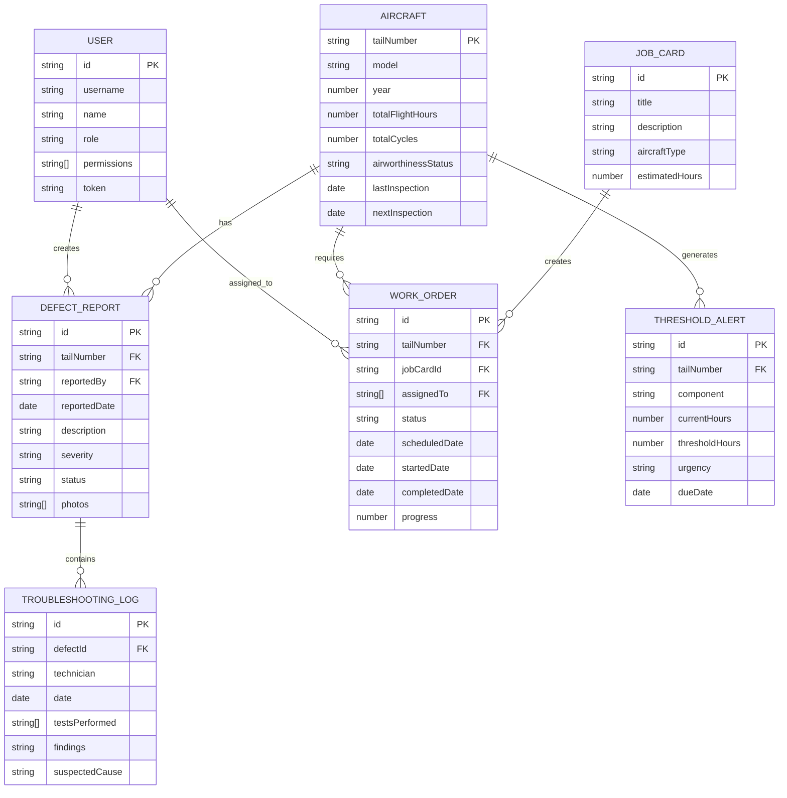

# Skyline Airlines Maintenance Subsystem - Technical Architecture Document

## 1. Architecture Design



## 2. Technology Description

### Subsystem Technologies
- **Fleet Health & Airworthiness**: React@19 + TypeScript@5 + Vite + shadcn/ui
- **Defect & Snag Management**: Vue.js@3 + TypeScript@5 + Vite + vu-shadcn
- **Crew Reporting Portal**: Svelte@4 + TypeScript@5 + Vite + svelte-shadcn

### Shared Technologies
- **Build Tool**: Vite@5 (all subsystems)
- **Styling**: TailwindCSS@3 + PostCSS
- **State Management**: Pinia (Vue), Context API (React), Stores (Svelte)
- **Routing**: React Router v6, Vue Router v4, SvelteKit Routing
- **UI Components**: shadcn/ui variants adapted for each framework
- **SSO Integration**: Custom authentication service with JWT tokens

### Development Tools
- **Initialization Tool**: vite-init for all subsystems
- **Package Manager**: pnpm with workspace configuration
- **Code Quality**: ESLint + Prettier + TypeScript strict mode
- **Testing**: Vitest + @testing-library variants for each framework

## 3. Route Definitions

### Fleet Health Subsystem (React)
| Route | Purpose |
|-------|---------|
| /fleet | Fleet overview dashboard with aircraft status summary |
| /fleet/aircraft | Aircraft registry with detailed aircraft information |
| /fleet/thresholds | Component threshold monitoring and alerts |
| /fleet/utilization | Flight hours and cycles logging interface |
| /fleet/status/:tailNumber | Individual aircraft airworthiness status page |

### Defect Management Subsystem (Vue)
| Route | Purpose |
|-------|---------|
| /defects | Defect dashboard with summary statistics |
| /defects/report | Snag reporting form for flight crew |
| /defects/track | Active defect tracking and management |
| /defects/troubleshoot/:id | Troubleshooting log for specific defect |
| /defects/signoff/:id | Digital sign-off interface for technicians |

### Crew Reporting Portal (Svelte)
| Route | Purpose |
|-------|---------|
| /reporting | Crew reporting dashboard with quick actions |
| /reporting/new | New snag/defect report form |
| /reporting/history | Personal reporting history for crew member |
| /reporting/aircraft/:tailNumber | Aircraft-specific reporting interface |

### Shared Routes (Microfrontend Shell)
| Route | Purpose |
|-------|---------|
| / | Unified dashboard with subsystem navigation |
| /login | SSO login page with company branding |
| /profile | User profile and preferences |
| /notifications | System-wide notifications center |

## 4. API Definitions

### Mock API Structure (Client-side Implementation)

#### Authentication APIs
```typescript
// Login Request
interface LoginRequest {
  username: string;
  password: string;
  subsystem?: 'fleet' | 'defects' | 'reporting';
}

// Login Response
interface LoginResponse {
  token: string;
  user: {
    id: string;
    name: string;
    role: 'engineer' | 'technician' | 'crew' | 'manager';
    permissions: string[];
  };
  subsystems: string[];
}
```

#### Fleet Health APIs
```typescript
// Aircraft Data
interface Aircraft {
  tailNumber: string;
  model: string;
  year: number;
  totalFlightHours: number;
  totalCycles: number;
  airworthinessStatus: 'airworthy' | 'restricted' | 'grounded';
  lastInspection: string;
  nextInspection: string;
}

// Threshold Alert
interface ThresholdAlert {
  id: string;
  tailNumber: string;
  component: string;
  currentHours: number;
  thresholdHours: number;
  urgency: 'low' | 'medium' | 'high' | 'critical';
  dueDate: string;
}
```

#### Defect Management APIs
```typescript
// Defect Report
interface DefectReport {
  id: string;
  tailNumber: string;
  reportedBy: string;
  reportedDate: string;
  description: string;
  severity: 'aog' | 'mel' | 'deferred';
  status: 'open' | 'in-progress' | 'pending-inspection' | 'closed';
  photos?: string[];
  troubleshooting?: TroubleshootingLog[];
}

// Troubleshooting Log
interface TroubleshootingLog {
  id: string;
  technician: string;
  date: string;
  testsPerformed: string[];
  findings: string;
  suspectedCause: string;
}
```

#### Work Order APIs
```typescript
// Job Card
interface JobCard {
  id: string;
  title: string;
  description: string;
  aircraftType: string;
  estimatedHours: number;
  requiredParts: PartRequirement[];
  procedures: ProcedureStep[];
}

// Work Order
interface WorkOrder {
  id: string;
  tailNumber: string;
  jobCardId: string;
  assignedTo: string[];
  status: 'scheduled' | 'in-progress' | 'pending-inspection' | 'completed';
  scheduledDate: string;
  startedDate?: string;
  completedDate?: string;
  progress: number;
}
```

## 5. Data Model

### Client-side Data Structures



## 6. Mock Data Implementation

### Mock Data Generation Strategy
- **Aircraft Fleet**: 25-30 aircraft with realistic tail numbers, models (A320, B737, CRJ900), and flight hours
- **Defect Reports**: 50-100 historical defects with varied severity levels and statuses
- **Work Orders**: 30-50 active and completed work orders with realistic timelines
- **Threshold Alerts**: Dynamic generation based on aircraft flight hours and maintenance schedules
- **User Data**: Role-based user accounts with appropriate permissions

### Client-side Storage
- **LocalStorage**: User preferences, cached data, offline capability
- **SessionStorage**: Authentication tokens, temporary form data
- **IndexedDB**: Large datasets, image attachments, historical records
- **Memory Store**: Real-time state management, cross-subsystem communication

### Mock API Implementation
- **Response Delays**: Simulate realistic network latency (100-500ms)
- **Error Handling**: Random failure scenarios for robust error handling testing
- **Data Validation**: Client-side validation matching backend constraints
- **Offline Support**: Service worker implementation for offline functionality

## 7. Design System Implementation

### shadcn/ui Component Mapping
- **React Subsystem**: Direct shadcn/ui components with TypeScript interfaces
- **Vue Subsystem**: vu-shadcn components with Vue 3 Composition API
- **Svelte Subsystem**: svelte-shadcn components with Svelte stores

### Consistency Requirements
- **Pixel-Perfect Matching**: Identical spacing, colors, typography across all frameworks
- **Animation Timing**: Consistent transition durations and easing functions
- **Interactive States**: Hover, focus, active, disabled states match exactly
- **Responsive Behavior**: Identical breakpoint handling and layout adjustments

### Cross-Framework Communication
- **Custom Events**: Framework-agnostic event system for subsystem communication
- **Shared State**: Centralized state management for user data and preferences
- **Navigation Sync**: Unified routing that maintains state across subsystems
- **Theme Consistency**: Dynamic theme switching applied across all subsystems